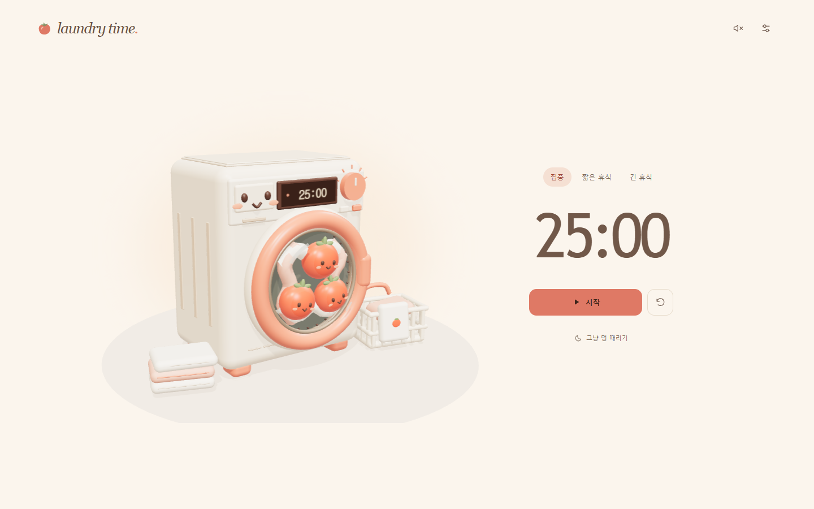
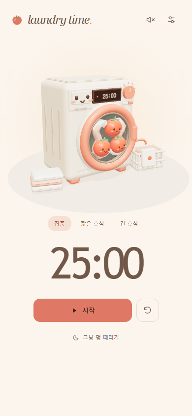

<div align="center">

# 🍅 laundry time.

**할 일은 가볍게, 마음은 보송하게.**

토마토 친구들이 빙글빙글 도는 작은 세탁소.<br>
집중이 필요할 때도, 그냥 멍 때리고 싶을 때도.

**[라이브 데모 열기 ↗](https://jeiel85.github.io/laundry-time/)** · [의견 남기기](https://github.com/jeiel85/laundry-time/issues)

[](https://github.com/jeiel85/laundry-time/actions/workflows/pages.yml)

`Three.js` · `JavaScript` · `Web Audio` · `Vite`

</div>

[](https://jeiel85.github.io/laundry-time/)

## 그냥, 세탁기 돌아가는 게 보고 싶어서

가만히 돌아가는 세탁기를 보고 있으면 조금 느긋해지잖아요.<br>
그 기분에 뽀모도로 타이머를 더했어요. 크림색 세탁기, 코랄색 문, 통 안의 토마토 친구들까지 전부 코드로 만들었습니다.

## 작은 세탁소에서 할 수 있는 일

| 코스 | 기본 시간 | 이렇게 써요 |
| --- | --- | --- |
| 🍅 집중 | 25분 | 한 번에 하나씩, 할 일에 집중하기 |
| ☕ 짧은 휴식 | 5분 | 잠깐 일어나서 몸 풀기 |
| 🌿 긴 휴식 | 15분 | 집중을 네 번 마쳤다면 길게 쉬기 |
| 🌙 그냥 멍 때리기 | 시간 제한 없음 | 돌아가는 세탁기를 가만히 구경하기 |

- **빙글빙글, 살짝 덜컹.** 드럼이 40RPM으로 회전하고 몸체는 작게 흔들려요. 세탁기를 톡 건드리면 조금 더 덜컹거립니다.
- **내 리듬에 맞게.** 설정에서 집중·휴식 시간을 바꿀 수 있어요. 다음 코스는 준비됐을 때 직접 시작합니다.
- **소리도 코드로.** 스피커 버튼을 켜면 부드러운 세탁 소리와 완료 알림이 나요. 기본은 무음입니다.
- **작은 화면에서도.** 모바일 화면과 키보드 조작을 지원하고, 기기의 동작 줄이기 설정을 따릅니다.
- **다시 와도 이어서.** 설정과 타이머 진행 상태를 브라우저에 저장해요. 가입이나 서버는 필요하지 않습니다.

<details>
<summary>📱 모바일 화면 보기</summary>

<p align="center">
  
</p>

</details>

## 시작하기

설치 없이 **[라이브 데모](https://jeiel85.github.io/laundry-time/)**에서 바로 사용할 수 있어요.

직접 실행하려면 Node.js 20.19+ 또는 22.12+가 필요합니다. 자동 배포에서는 Node.js 24를 사용합니다.

```sh
git clone https://github.com/jeiel85/laundry-time.git
cd laundry-time
npm ci
npm run dev
```

터미널에 표시된 로컬 주소로 접속하세요.

| 명령어 | 하는 일 |
| --- | --- |
| `npm run dev` | 개발 서버 실행 |
| `npm test` | 타이머 로직 검증 |
| `npm run build` | 배포용 정적 파일을 `dist/`에 생성 |
| `npm run preview` | 빌드한 화면을 로컬에서 확인 |

**조작:** 시작 버튼 또는 `Space`로 시작·일시정지, 옆의 되돌리기 버튼으로 초기화합니다. 시간 설정을 저장하면 현재 타이머도 초기화돼요.

## 외부 애셋 없이 만들었어요

이미지·3D 모델·텍스처·웹폰트·음원을 불러오지 않습니다. Three.js와 Vite는 npm 의존성이며, 필요한 코드는 빌드에 포함됩니다. 위 스크린샷은 README용으로만 사용해요.

| 화면의 요소 | 만든 방법 |
| --- | --- |
| 세탁기·토마토·수건·바구니 | Three.js의 기본 도형과 곡선을 조합한 직접 모델링 |
| 빛과 그림자 | 코드로 구성한 조명·환경·재질 |
| 세탁기 디스플레이 | Canvas로 그린 화면을 텍스처로 사용 |
| 아이콘 | 직접 작성한 SVG |
| 세탁 소리·완료 알림 | Web Audio API로 실시간 합성 |

<details>
<summary>구현과 동작에 대해 조금 더</summary>

### 회전과 움직임

일반 세탁 단계의 드럼 속도인 30~45RPM을 참고해 **40RPM, 1.5초에 한 바퀴**로 맞췄습니다. 가속·감속은 부드럽게 처리하고, 회전 속도가 빨라져도 몸체의 흔들림은 작게 유지합니다. 기준 자료는 [NXP AN3234 §4](https://www.nxp.com/docs/en/application-note/AN3234.pdf)입니다.

설정에서 움직임을 끌 수 있고, `prefers-reduced-motion`이 켜진 환경에서는 회전과 덜컹거림을 줄입니다. 3D 화면에는 WebGL 2가 필요하며, 사용할 수 없는 환경에서도 타이머는 동작합니다.

### 시간과 저장

종료 시각을 기준으로 남은 시간을 계산해 백그라운드 탭의 타이머 지연을 보정합니다. 설정·진행 상태·완료 기록은 `localStorage`에 저장하고, 날짜는 사용자 기기의 현지 날짜를 따릅니다. 저장소를 사용할 수 없으면 안내 후 메모리에서 동작합니다.

브라우저를 닫으면 소리는 나지 않으며, 다시 열었을 때 완료 여부를 확인합니다. 새로고침 후에는 사용자 동작을 거쳐 오디오를 활성화합니다. 별도의 서버·계정·분석 도구는 사용하지 않습니다.

### 파일 구성

```text
src/
├── scene.js     # 3D 모델링·조명·회전·덜컹거림
├── timer.js     # 타이머·코스 전환·기록 복원
├── audio.js     # 세탁 소리·완료 알림 합성
├── main.js      # 화면 조작·설정·저장
└── style.css    # 반응형 레이아웃
tests/
└── timer.test.js
```

</details>

## 데모 자동 배포

`main`에 푸시하면 **의존성 설치 → 타이머 테스트 → 빌드 → GitHub Pages 배포** 순서로 실행됩니다.

배포 설정은 [`.github/workflows/pages.yml`](.github/workflows/pages.yml)에 있습니다. GitHub Pages용 빌드에만 `--base /laundry-time/`을 지정하므로 로컬 실행과 다른 호스팅의 기본 빌드에도 사용할 수 있어요. Actions 탭에서 수동 배포도 가능합니다.

---

<p align="center">한 바퀴씩, 나의 속도로. 🍅</p>
